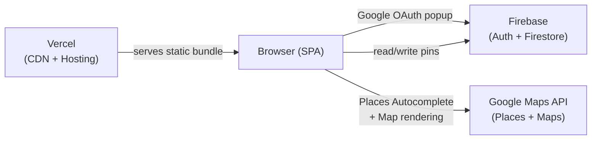
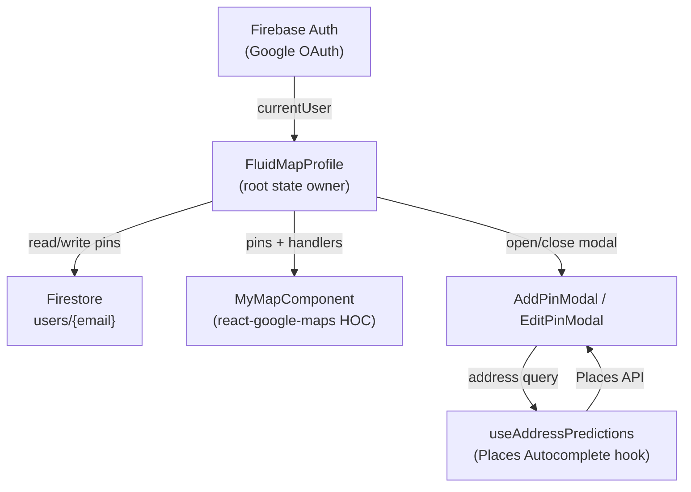

# Architecture — geogra.me

> Last updated: November 2026

## System Overview

**geogra.me** is a single-page application (SPA) that lets users build a personal push-pin world map, categorize visited/planned/lived locations, and share their public profile via a unique URL.



### Route Map

| Route | Component | Access |
|---|---|---|
| `/` | `LoginPage` | Public (redirects if authed) |
| `/profile` | `FluidMapProfile` | Authenticated |
| `/profile/:userId` | `FluidMapProfile` | Public (read-only) |

---

## Tech Stack

| Layer | Technology | Version | Notes |
|---|---|---|---|
| **Framework** | React | 16.8.6 | Class + function components; no upgrade scheduled yet |
| **Bundler** | Create React App | 5.0.1 | CRA (unmaintained); Vite migration flagged below |
| **Routing** | React Router | 5.x | `<Switch>` / `<Route>` |
| **UI Library** | Semantic UI React | 0.88.x | Component library + CSS |
| **Maps** | react-google-maps | 9.4.5 | Archived/deprecated wrapper |
| **CSS-in-JS** | styled-components | 5.x | Primary |
| **CSS-in-JS** | Emotion | (legacy) | Appears unused; candidate for removal |
| **Backend** | Firebase (compat) | ^12.17.0 | Auth (Google OAuth) + Cloud Firestore |
| **Deployment** | Vercel | — | Static SPA; recently migrated from Netlify |
| **Node** | Node 20 | `.nvmrc` | EOL April 2026 — upgrade to 22 LTS is a priority |
| **CI** | GitHub Actions | — | Dependabot auto-merge for minor/patch PRs |

---

## Architectural Patterns

### Component Architecture

- **Class components** are the primary pattern (`FluidMapProfile`, `MapProfile`, `AddPinModal`, etc.). The app predates hooks being widespread.
- **Function components + hooks** are used in newer additions (`useAddressPredictions` custom hook, some smaller components).
- **No global state store** — state lives in `FluidMapProfile` (the root authenticated component) and is passed down via props.

### Data Flow



### Firebase Data Model

Collection: `users` — keyed by user **email address**.

```
users/{email}
  displayName: string
  photoURL: string
  pins: Pin[]

Pin {
  name: string         // display name of the place
  location: LatLng     // { lat, lng }
  placeId: string      // Google Places ID
  country: string
  label: PinLabel      // see below
  monthVisited: number
  yearVisited: number
  comment: string
  rating: number       // 1–5
}
```

**Pin Labels & Map Marker Colors:**

| Label | Color |
|---|---|
| Been To | Blue |
| Want To Go | Red |
| Lived | Purple |
| Family | Orange |
| Friends | Green |
| Born | Yellow |

### Authentication

- Google OAuth popup via Firebase Auth (`firebase/compat/auth`)
- Auth state drives routing: unauthenticated users are redirected to `/`
- Public profile pages (`/profile/:userId`) are accessible without auth (read-only Firestore query)

### Map Rendering

- `MyMapComponent` is a `react-google-maps` HOC (`withScriptjs` + `withGoogleMap`)
- Rendered full-viewport via a flex layout in `FluidMapProfile`
- `header.js` and `footer.js` exist in the codebase but are **not used** in the main layout

---

## Directory Structure

```
geogra-me/
├── .agents -> ~/src/.agents    # symlink to shared agent config repo
├── .github/
│   └── workflows/
│       └── dependabot-automerge.yml
├── .nvmrc                      # Node 20
├── plans/                      # agent-generated plans (gitkeep)
├── public/
│   ├── index.html
│   ├── manifest.json
│   └── _redirects              # stale Netlify artifact — safe to delete
├── src/
│   ├── components/
│   │   ├── AddPinModal.js      # Create new pin
│   │   ├── CountryCounter.js   # Displays unique country count
│   │   ├── EditPinModal.js     # Edit existing pin
│   │   ├── FluidMapProfile.js  # Root authenticated view (owns all state)
│   │   ├── LoginPage.js        # Google OAuth login
│   │   ├── MapProfile.js       # Map + sidebar shell
│   │   ├── MyMapComponent.js   # react-google-maps HOC
│   │   ├── PinList.js          # Sidebar list of pins
│   │   ├── PinListItem.js      # Single pin in sidebar
│   │   ├── header.js           # Unused
│   │   ├── footer.js           # Unused
│   │   └── ...                 # Additional UI components
│   ├── hooks/
│   │   └── useAddressPredictions.js  # Places Autocomplete
│   ├── fire-config.js          # Firebase initialization (compat SDK)
│   ├── utils.js                # Shared helpers
│   ├── App.js                  # Router setup
│   └── index.js                # Entry point
├── .env                        # Local environment variables (gitignored)
├── vercel.json                 # SPA rewrite rule (/* → /index.html)
└── package.json
```

---

## Constraints & Known Issues

| Issue | Severity | Notes |
|---|---|---|
| Missing `.env.example` template | 🟢 Low | `.env` is properly gitignored, but there is no template file documenting required keys for new setups. |
| `NODE_OPTIONS=--openssl-legacy-provider` | 🟡 Medium | Required because CRA + Webpack 4 is incompatible with OpenSSL 3 (Node 17+). Resolved by migrating to Vite. |
| `public/_redirects` | 🟢 Low | Stale Netlify artifact; `vercel.json` handles SPA routing. Safe to delete. |
| `header.js` / `footer.js` | 🟢 Low | Unused components — dead code, can be removed. |
| Emotion dependency | 🟢 Low | Appears unused alongside styled-components. Can audit and remove. |

---

## Short-Term Upgrade Audit

Deferred: React 16 → 18/19, `react-google-maps` → `@vis.gl/react-google-maps` (breaking changes, larger effort).

| Priority | Item | Why | Effort |
|---|---|---|---|
| 🔴 **High** | Node 20 → 22 LTS | Node 20 EOL April 2026. Update `.nvmrc`, Vercel runtime, and CI. | Low |
| 🟡 **Medium** | CRA → Vite | CRA is unmaintained; Vite resolves the OpenSSL workaround, is significantly faster, and aligns with the ecosystem. | Medium |
| 🟡 **Medium** | Firebase compat → Modular v9+ SDK | Tree-shaking support, smaller bundle, official migration path. | Medium |
| 🟢 **Low** | Add `.env.example` template | Documents required environment variables for local development without exposing keys. | Low |
| 🟢 **Low** | Delete `public/_redirects` | Dead Netlify file; `vercel.json` already handles SPA routing. | Trivial |
| 🟢 **Low** | Remove unused code | `header.js`, `footer.js`, Emotion dependency. | Low |
| ⚪ **Deferred** | React 16 → 18/19 | Breaking changes in class components + third-party libs. Revisit after Vite migration. | High |
| ⚪ **Deferred** | `react-google-maps` → `@vis.gl/react-google-maps` | Archived library but functional; migration is a full rewrite of map layer. | High |
